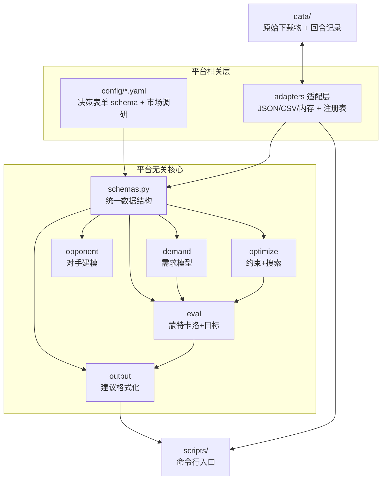

# 架构与模块边界

## 分层



## 各模块职责

| 模块 | 路径 | 职责 | 依赖 |
|---|---|---|---|
| 统一数据结构 | `src/cda/schemas.py` | 决策、状态、结果、调研、建议的核心对象 | 无（依赖根） |
| 数据适配层 | `src/cda/adapters/` | 把外部数据形态转成 `TurnRecord`，多种接口 + 注册表 | schemas |
| 需求模型 | `src/cda/demand/` | 从回合记录估计需求参数，预测份额 | schemas |
| 对手建模 | `src/cda/opponent/` | 对手类型识别与档案 | schemas |
| 优化器 | `src/cda/optimize/` | 约束定义 + 搜索最优决策 | schemas |
| 评估层 | `src/cda/eval/` | 情景模拟、代理目标、不确定性分布 | schemas、demand |
| 输出层 | `src/cda/output/` | 把结果格式化成人类可读建议 | schemas |
| 命令行入口 | `scripts/` | 端到端演示与批处理 | 以上全部 |

## 关键设计决策

1. **平台无关核心**：真实字段名只出现在 `config` 与 `adapters`，换平台只改配置与适配器。
2. **统一数据结构先行**：`schemas.py` 是全项目依赖根，任何模块都围绕它。
3. **小样本在线学习**：需求模型用「logit 吸引力基线 + 可在线更新」，不引入需要大量数据训练的模型。
4. **人类在环**：优化器的输出经过 `output/recommend.py` 转为「建议 + 依据 + 置信度 + 备选 + 风险」。
5. **多接口适配**：`adapters/registry.py` 提供命名注册，当前有 `json`（完整记录）、`csv`（Excel 友好决策日志）、`memory`（测试/会话）。

## 数据流（每回合）

```
人工录入/手动导出 → adapters(JSON) → TurnRecord[] → demand.fit → DemandModel
    → optimize(约束+DE) + eval(蒙特卡洛) → Recommendation → output.to_markdown
    → 终端/脚本输出 → 人类讨论定稿 → 人工提交平台
```
